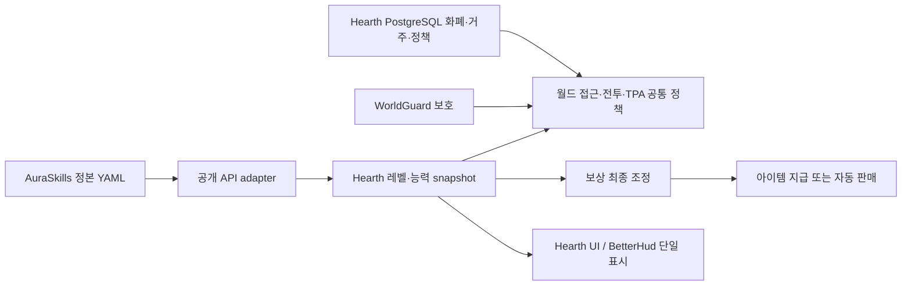

# AuraSkills 기술 검증과 경제 서버 통합 설계

검증일: 2026-11-20. 범위는 **기술 검증·구현 방식 선정**이다. 정식 기능·운영 설치·밸런싱을 구현하지 않았다. 사용자가 이번 실제 클라이언트 시험을 보류했다. 따라서 접속자 0명의 실제 Paper 구동, 데이터 API, WorldGuard 질의, 순수 정책 모델을 실제 채취·스킬 발동·사망·이동·화면의 성공으로 해석하지 않는다.

## 1. 정상 사용 가능 여부와 시험 기준

**판단: AuraSkills를 경제 서버의 숙련도·레벨·스탯 기반으로 채택할 수 있다. 공개 API와 Hearth 정책 모듈을 결합하고 원본 포크는 피한다.** 커스텀 액티브 설정 키의 upstream 불일치를 발견했고 콘텐츠 설정으로 회피했다. 전체 게임 동작의 수용 판정은 실제 클라이언트 시험 후에 가능하다.

| 대상 | 고정 기준 |
| --- | --- |
| AuraSkills | 공식 [2.4.0 배포](https://github.com/Archy-X/AuraSkills/releases/tag/2.4.0), 2026-09-20 게시 |
| JAR SHA-256 | `de54cbd2e33d65e8b1704751ae4121ed2f5b466ba89c63a1aadf3a3e629d6a40`, GitHub 배포 digest와 대조 |
| 분석 소스 | [148cb00d29bf6d3733adc2477129f1361ee894da](https://github.com/Archy-X/AuraSkills/tree/148cb00d29bf6d3733adc2477129f1361ee894da), tag 2.4.0 |
| 실제 JVM | Paper 26.2 build 134 / Java 25.0.5 |
| 보호 | WorldEdit 7.4.4 / WorldGuard 7.0.19 |
| Hearth | 기존 거주 배치 JAR, SHA `bf5e1717c15366867c32dfd7ab71f72b7f6deec285233dd4637803859083fabe` |
| 선택 HUD | BetterHud 2.1.0-SNAPSHOT-448, 기존 고정 아티팩트 |

공식 지원 표시는 실행 증거와 별개다. 실제 실행 결과·해시·시험 경로는 [기계 판독 기록](../verification/auraskills-technical-result.json)에 모았다. 원시 로그는 그 경로에 보존하며 Git에는 대용량 JAR·외부 소스·DB·로그를 넣지 않는다. 기존 운영 환경, 원본 시험 월드/DB와 스토리 데이터는 보존한다.

## 2. 요구 기능별 구현 가능성과 증거 수준

표에서 **실행**은 격리 Paper 또는 명시한 순수 모델이며, **소스**는 실행하지 않은 구현 가능성 판단이다.

| 요구 | 판정·이번 증거 | 정식 구현 방식 / 남은 검증 |
| --- | --- | --- |
| Paper 26.2·Java 25 | 실행: 플러그인 enable·레지스트리·파일 IO | 최신 다른 빌드 전체에 대한 보장은 아님 |
| Hearth·WG 충돌 | 실행: 동시 enable, 기존 PG 연결, WG 플래그 등록·권한 질의 | 실제 보호 우회·게임 이벤트 충돌은 보류 |
| 숙련도·레벨·스탯 | 실행: 커스텀 등록, raw XP 레벨 상승, modifier 계산·제거 | 채취/사냥으로 정상 XP 획득·전투 능력치 효과는 보류 |
| 패시브·액티브 | 실행: 패시브 수식, 액티브 비용·쿨다운 데이터, 마나 API | 발동·지속·해제·월드 이동 중 효과는 보류 |
| 커스텀 숙련도·스탯·스킬 | 실행: 공개 registry 등록·로드, 직접 정의한 수식 | 게임 효과는 Hearth 이벤트 처리기를 별도로 작성 |
| 강화·커스텀 인챈트 연동 | 실행: 실제 ItemStack의 Sharpness V·강화 PDC·Aura modifier 공존, Paper 직렬화 복원 | 미래 강화/인챈트 플러그인은 미선정·미실행, 실제 장착 효과 보류 |
| 월드별 능력·XP 제한 | 실행: blocked/disabled 설정을 실제 로더가 읽음. 소스: WG XP·loot 제어 | 동적 월드 역할 브리지·실제 발동 중단 검증 필요 |
| HUD·커스텀 UI | 실행: BetterHud 동시 구동. 소스: API/PAPI 데이터 제공 | 렌더링·팩·화면 중복은 미검증 |
| 월드 PvP·소유자 설정 | 실행: WG region PvP deny→allow 질의, 6역할 모델 | 소유자 인증·PG revision·WG 반영, 실제 공격/투사체 시험 필요 |
| 사망 드랍·부적 | 실행: 순수 모델의 수량 보존·확률 분기·부적 1회 소비 | 실제 PlayerDeath/Respawn 인벤토리 계약과 장애 검증 필요 |
| 레벨 입장 조건·우회 차단 | 실행: specific/average/sum/all/custom 모델, 미로드 거부 | 모든 실제 이동 이벤트 통합·로그인/리스폰 시험 필요 |
| 고레벨 보상 감소 | 실행: 행동별 1회 결정 모델. 소스: XP·loot 이벤트 분석 | 협조하는 보상 생산자별 연결 필요. 임의 외부 플러그인 전부를 보장할 수 없음 |
| TPA·30초 전투 제한 | 실행: 수락자 검증·만료·이동 직전 재검사·상태 갱신 모델 | 정식 명령/요청/PG 복원/이동 구현과 실제 시험 필요 |
| 저장 안정성 | 실행: 실제 YAML 쓰기·읽기·새 JVM 복원 | 강제 종료/전원 장애·일관 백업 복구는 이번 미실행 |

`createNewUser(UUID, null)`은 별도 검증 JAR에서 만든 **합성 오프라인 데이터 레코드**다. Player를 만들거나 인증을 우회하지 않는다. 정상 `addSkillXp` 경로는 Player 없는 레코드에서 획득량 0이 되어 플레이 시험을 대체하지 못했다. `addSkillXpRaw`·직접 레벨 설정·파일 저장은 데이터 계약 검증에만 썼다. 내부 `storageProvider` 접근 역시 검증 도구 전용이며 권장 운영 API가 아니다.

## 3. AuraSkills 기본 기능과 공개 API 활용 범위

[공식 API 문서](https://wiki.aurelium.dev/auraskills/api)의 `AuraSkillsApi` / `AuraSkillsBukkit`, `SkillsUser`, namespaced registry, ItemManager를 우선 사용한다. 플러그인 JAR/API를 Hearth 배포 JAR에 포함하지 않고 `compileOnly`로 참조한다. 현재 검증 전용 source set은 일반 Hearth JAR에 들어가지 않는다.

- 기본 숙련도·XP 요구량·스탯·trait·패시브 수식·마나/기존 액티브는 AuraSkills가 담당한다. `isLoaded()` 확인 전 기본값을 실제 플레이어 레벨로 사용하지 않는다.
- 커스텀 skill/stat/ability/mana ability는 등록 가능하다. 선언만으로 채취 소스나 새로운 게임 효과가 생기지 않는다. 커스텀 XP source 또는 Hearth 이벤트 처리·공개 XP API가 추가로 필요하다.
- 커스텀 등록은 AuraSkills enable 후, 지연 콘텐츠 로드 전에 수행한다. 정식 연동은 해당 기능을 활성화한 경우 필수 의존성과 시작 순서를 고정하고 로드 실패 시 경제 접근을 HOLD한다.
- 아이템 능력치는 ItemManager와 안정된 이름의 modifier로 연결한다. 장비 슬롯·강화 소스별 키로 교체/제거하며 장착 상태에서 유도되는 modifier를 이중 영속화하지 않는다. ADD/ADD_PERCENT/MULTIPLY 순서·상한은 콘텐츠 정책으로 정한다. 바닐라 인챈트 피해와 trait 피해를 같은 보너스로 중복 변환하지 않는다.
- 정적 월드 이름의 `blocked_worlds` / `disabled_worlds`, WG의 `auraskills-xp-gain`·`auraskills-custom-loot` 및 숙련도별 플래그를 활용한다. 이 이름 목록은 Hearth의 동적 개인 월드 역할 레지스트리를 대신하지 못한다.
- `ManaAbilityActivateEvent` 취소, `XpGainEvent` 양 조정, `LootDropEvent` 추가 loot 취소가 가능하다. 이는 이미 발동 중인 모든 능력의 즉시 종료나 모든 외부 아이템 생성을 제어하는 범용 API가 아니다.

**확인한 2.4.0 제약:** `SkillRegistry.getDefinedConfig()`가 커스텀 mana 능력을 `mana_abilities` 키로 쓰지만 `SkillLoader.loadManaAbility()`는 `mana_ability`를 읽는다. 실제 첫 시험에서 등록된 custom mana 능력이 “not loaded”로 실패했다. Hearth 콘텐츠 디렉터리의 다음 설정을 제공하자 비용·쿨다운 조회가 성공했다. 원본 JAR은 수정하지 않았다.

```yaml
skills:
  hearthprobe/metallurgy:
    mana_ability: hearthprobe/measured_active
```

기존 액티브 구현체는 Bukkit 내부 provider에 등록되어 있다. 공개 커스텀 선언만으로 새 입력/효과가 자동 연결된다고 가정하지 않는다. 새 액티브는 Hearth 입력 리스너가 마나·권한·전투/월드·쿨다운을 확인하고 효과를 적용하는 방식을 권장한다. 내부 provider에 reflection으로 주입하는 방식은 피한다.

## 4. Hearth 자체 구현 범위

### 월드별 전투·사망

사용자가 지정한 표를 정책 데이터로 보존한다. 현재 구현된 거주/자원 오버월드/지옥 외에 **초보 자원·자원 엔드 역할 추가는 후속 구현**이다. 실제 수치·조건은 이번에 운영에 넣지 않았다.

| 역할 | PvP | 사망 경험치 손실 | 사망 아이템 드랍 |
| --- | --- | --- | --- |
| 기본 거주 | 불가 | 미정 | 미정 |
| 개인 거주 | 소유자 설정 | 없음 | 0% |
| 초보 자원 오버월드 | 불가 | 없음 | 0% |
| 일반 자원 오버월드 | 가능 | 1/3 | 5% |
| 자원 지옥 | 가능 | 1/3 | 5% |
| 자원 엔드 | 가능 | 바닐라 | 30% |

PvP는 WG 정본과 피해 경로 확인으로 적용한다. 개인 설정 변경은 **현재 소유자·월드 ID·PG revision** 확인 후 적용하고 실패하면 안전한 기존 정책을 유지한다. 투사체 소유자·펫/간접 피해의 PvP 귀속을 포함해야 한다.

사망은 Hearth의 단일 처리기가 원본 ItemStack 메타/슬롯을 보존한 채 유지 목록과 드랍 목록을 한 번 계산한다. Paper death keep 목록/keepInventory/vanishing 처리 계약을 검토하고, 기본 자동 드랍과 별도 수동 재지급을 동시에 실행하지 않는다. 부적 소비까지 같은 death ID·접속 세대에서 중복 처리하지 않고 native 인벤토리 저장·기존 경제 shadow CAS와 연결한다. DB 결과 불명 때 임의로 다시 아이템을 생성하지 않는다. native 플레이어 파일과 PG가 원자 트랜잭션을 이루지는 않으므로 기존 ADR-0003의 HOLD·수동 복구를 유지한다. 완전 무손실·복사 불가능의 운영 보장은 이번에 증명하지 않았다.

**확률 방식 비교:** 수량 n·확률 p이면 두 방식의 기대 드랍은 np로 같다. 개별 수량 판정의 분산은 np(1-p), 스택 판정은 n²p(1-p)이므로 스택 방식의 손실 편차가 크다. 사망 시 작은 인벤토리에 대해서만 개별 판정을 권장한다. 인챈트/PDC가 다른 스택은 섞지 않는다. 아이템별 확률 override는 material/tag/PDC 규칙으로 정책을 컴파일해 적용할 수 있다. 우선순위·귀속/퀘스트/장비 예외는 미정이다.

부적은 표시 이름 대신 서버 PDC 식별자·정상 소지/사용 가능 상태를 확인하고 하나만 소비한다. 부적이 아이템 드랍·바닐라 XP·Aura XP 중 어디까지 무효화하는지 별도 결정이 필요하다. `on_death.reset_skills/reset_xp`는 끄고 Hearth와의 이중 차감을 막는다. 바닐라 총 XP/레벨 진행률과 Aura 숙련도별 XP는 별도 저장·계산한다. 표의 “1/3”이 어느 XP에 적용되는지, 누적 전체 XP/현재 레벨 XP인지와 정수 반올림은 아직 확정하지 않았다. 엔드의 바닐라 방식도 Aura 레벨 초기화를 의미하지 않는다.

### 기본 거주 보호

WorldGuard를 그대로 정본으로 사용한다. 공용 구획 owner와 건축 member를 관리하고, 상호작용만 허용할 사람은 **건축 region membership에 바로 추가하지 않는다**. 상자/오브젝트별 자식 region의 member와 `chest-access`, `use`, `interact` 그룹을 이용한다. 건축/파괴 거부는 부모 정책과 별도 유지한다. 전체 공개는 해당 상호작용 flag만 all 허용하고 건축은 열지 않는다. WG는 같은 region의 동일 flag에 여러 그룹별 값을 동시에 둘 수 없으므로 복잡한 ACL은 자식 region·우선순위/상속으로 표현한다. [공식 flag 계약](https://worldguard.enginehub.org/en/latest/regions/flags/)과 이번 membership query 시험을 함께 적용한다.

피스톤·호퍼/호퍼 마인카트·물/용암·폭발·화염·동물/액자/갑옷 거치대·경계 밖 투사체·자동화의 보호 우회는 **검증 항목으로 남는다**. WG 비플레이어 보호 도메인을 구획 간 무분별하게 공유하지 않고 WG 월드 설정의 보호 옵션을 먼저 사용한다. 흐름 flag는 high-frequency 설정·비용 조건이 있다. 표준 WG가 처리하지 못하는 것으로 확인된 외부 플러그인 경로만 Hearth에서 보완한다. 이번 domain query 성공을 간접 약탈 차단의 실제 성공으로 간주하지 않는다.

### 공통 입장 제어·TPA·전투 상태

Hearth의 월드 역할 UUID 레지스트리에 `WorldAdmissionPolicy`를 붙인다. 개별 숙련도, 명시한 집합의 평균/합산, 복수 조건 AND, namespaced custom skill을 모두 표현할 수 있다. 평균 분모는 설정한 숙련도 집합으로 고정한다. Aura 신규 숙련도가 추가됐다고 자동으로 요구 레벨이 달라지게 하지 않는다. 데이터 미로드·skill 없음·정책 미확인은 거부하고 안전한 거주 위치에 대기시킨다. 숫자와 산정 방식은 미정으로 둔다.

TPA/Home/월드 메뉴/포탈/플러그인 텔레포트의 **요청 시점과 최종 이동 직전**에 같은 검사를 사용한다. `PlayerTeleportEvent`·portal·Paper respawn 위치 선택·join 초기 위치/재입장 처리에 연결하고, 월드 변경 후 감시는 우회 탐지와 안전 복귀 보조로 사용한다. 검사 뒤 비동기 이동 전에 정책/소유권/접속 세대가 바뀌면 재검사한다. 재접속 시 이전 저장 위치가 잠긴 자원 월드면 그곳에 노출하기 전에 격리/안전 위치로 배치한다. 거주 월드의 레벨 조건은 제외하되 개인 거주 ACL은 유지한다. 임의의 악성 플러그인이 이벤트 취소를 무시하거나 NMS로 이동시키는 경우까지 Bukkit 리스너로 보장할 수 없으며 설치 플러그인을 통제해야 한다.

전투 서비스는 UUID→만료시각의 O(1) 캐시로 공격자·피격자를 모두 30초 태그하고 추가 유효 피해 시 갱신한다. TPA 수락과 실제 이동 양쪽에서 양측 상태·레벨·목적지 ACL·요청 만료/사용 여부를 다시 확인한다. Home/월드/포탈도 같은 서비스를 사용한다. 로그아웃으로 태그를 지우지 않는다. 다른 backend로 이동을 허용하려면 단일 writer/전환 계약에 만료시각을 전달해야 한다. 피해마다 동기 PG 쓰기는 하지 않는다. 재시작까지 우회를 차단하려면 비동기 저장 확인·전환 HOLD와 비정상 종료 후 안전 대기 정책이 필요하다. 이번 모델의 restore 검사는 실제 PG 영속 구현의 증거가 아니다. 강제 리스폰·관리자 구조 이동의 예외는 명시적인 내부 목적 타입으로 제한한다.

## 5. 보상 감소·기능 충돌과 한계

고레벨 기준 산정은 위 level policy를 재사용한다. 아이템 50% 미발생과 바닐라 XP 50% 미발생은 별도 채널의 추첨, Aura 최종 XP는 0.5배로 표현할 수 있다. 서로 같은 난수를 공유할지와 광역 작업의 판정 단위는 미정이다. 순수 모델은 독립 채널 예시를 검증했을 뿐 콘텐츠 정책을 확정하지 않았다.

| 생산 경로 | 활용 지점 | 주의점 |
| --- | --- | --- |
| 바닐라 블록·Fortune | `BlockDropItemEvent`의 실제 생성 목록 | Fortune 계산 뒤 처리. 취소 후 수동 재드랍과 원본 중복 금지 |
| 바닐라 몹·Looting | `EntityDeathEvent`의 drops/exp | 다른 리스너가 이후 추가하면 다시 우회될 수 있음 |
| 바닐라 블록 XP | `BlockExpEvent`/break 경로 | 아이템 성공 여부와 독립. ItemSpawn 이벤트만으로는 XP를 제어 못함 |
| Aura 추가 loot·직접 인벤 지급 | `LootDropEvent` 취소/변경 | 기본 loot 목록과 별도 경로이며 직접 지급도 존재 |
| Aura 광역/전체 벌목 | `ManaAbilityBlockBreakEvent`, `ManaAbilityBlockDropItemEvent` 및 구현체별 경로 | 일반 블록 이벤트만 구독하면 누락 가능, Terraform 등도 소스별 확인 |
| Aura XP | **`XpGainEvent` 단일 등록**에서 양 변경 | 이미 multiplier 적용 후. Entity/Damage 파생 이벤트는 같은 HandlerList를 상속하므로 각각 중복 등록하면 안 됨 |
| 커스텀 drop·자동 판매·특수 인챈트 | Hearth 공통 보상 API | 개별 plugin 협조 계약이 없으면 완전한 최종 후처리를 보장할 수 없음 |

Aura `BlockLootHandler`는 BlockBreak HIGHEST에서 별도 loot를 지급할 수 있어 vanilla 최종 drop만 줄이는 구현은 틀린다. MONITOR에서 다른 플러그인 결과를 수정하는 방식도 권장하지 않는다. 동일 HIGHEST의 실행 순서나 다음 tick의 근처 ItemEntity 탐색은 일반적인 정확성 보장이 아니다. 다른 플레이어의 loot를 지울 위험도 있다.

**권장 방식:** `RewardCoordinator`가 행동 ID(플레이어/월드/세대/원인)를 만들고, 보상 생산자가 채널별 최종 결과를 제출한다. Fortune/Looting·Aura 보너스 계산 후 suppression을 한 번 적용하고, 아이템 생성 또는 직접 지급 또는 자동 판매 중 하나의 지급 경로로 확정한다. 자동 판매는 페널티 후 잔여 결과만 받는다. 각 채널의 이미 처리한 결과를 재사용하며 XP와 아이템 추첨을 혼동하지 않는다. 광역 작업은 하위 블록별 ID와 부모 작업 ID를 구분한다. 비협조 드랍 능력은 끄거나 대체하는 것이 “다 지원”보다 안정적이다. 보상마다 아이템별 PG 트랜잭션을 추가하지 않고 메인 스레드의 짧은 수명 캐시·작업 종료 정리와 기존 거래 저장 경계를 재사용한다.

공개 raw XP API는 multiplier/event를 우회할 수 있다. 정식 Hearth·향후 인챈트 구현은 정상 XP gateway를 통해서만 호출하고 raw는 명시적 관리자 복구로 제한한다. 이 계약 밖 다른 플러그인의 raw 호출까지 단일 XP 이벤트로 막을 수는 없다.

## 6. 저장 방식 비교와 추천

[공식 SQL 문서](https://wiki.aurelium.dev/auraskills/main-config/sql)는 YAML과 MySQL/MariaDB를 설명한다. 고정 소스의 `StorageType`은 YAML/MYSQL뿐이며 factory도 두 구현을 직접 만든다. MySQL JDBC driver/URL, `ON DUPLICATE KEY UPDATE`, `INSERT IGNORE`, `AUTO_INCREMENT`, `JSON_ARRAYAGG(JSON_OBJECT(...))`가 사용된다. PostgreSQL JDBC URL로 바꾸는 설정만으로 동작하지 않는다. 이번에 별도 MySQL 서버 설치나 PG 어댑터 구현은 하지 않았다.

| 방식 | 성능·자원 | 안정성·백업·확장 | 구현/유지비 | 판단 |
| --- | --- | --- | --- | --- |
| Aura YAML + 기존 Hearth PG | 새 DB 프로세스 0, 플레이 중 메모리 캐시, IO는 파일 수에 비례 | 단일 경제 writer에 적합. 파일/PG 공통 시점 백업 필요. 여러 backend가 같은 파일에 동시 쓰기 금지 | 가장 낮음, upstream 그대로 | **현재 권장** |
| Aura 전용 MySQL/MariaDB + Hearth PG | 추가 DB RSS/CPU·pool·운영 비용. 실제 비용은 이번 미측정 | 큰 사용자 집합/여러 서버 지원 경로. 공유 DB만으로 동시 writer 충돌이 사라지지는 않음 | 공식 저장 계층 재사용, DB 이원화 운영·모니터링/복구 부담 | 필요 증거 발생 후 전환 |
| PostgreSQL 어댑터/포크 | 추가 DB daemon 없이 기존 PG 자원 사용, 비용 실측 없음 | 트랜잭션/SQL 변환·스키마·마이그레이션·복원 전부 책임 | 높음, 매 업데이트 회귀·포크 추적 | 현재 비추천 |
| 공개 API로 PG 이중 저장 | 겉보기 통합, 저장 두 번·데이터 복제 | 두 정본의 충돌/순서/복구 복잡성 증가. 공개 API로 원래 저장 계층 교체 불가 | 중~높음, 정합성 부담 | 정본 대체로 비추천 |
| SQLite·H2·JDBC 프록시 등 | 추가 구성별 상이 | 2.4.0 공식 provider 없음. MySQL SQL 호환을 별도로 책임 | PG 포트와 비슷한 비공식 비용 | 현재 이득 없음 |

YAML은 UUID별 `userdata/*.yml`에 숙련도 레벨·XP·마나·modifier 등 사용자 상태를 저장하며 다른 설정/지역/백업 파일도 있다. 실제 시험 파일에는 `uuid`, `skills.<namespace/key>.{level,xp}`, `mana`, `stat_modifiers`의 name/stat/operation/value, `action_bar.idle`가 기록됐다. SQL 소스의 구조는 prefix가 붙은 `users`(UUID unique·내부 ID·마나/locale), `skill_levels`(user ID+skill 이름 복합 PK·level/XP), `key_values`(분류별 데이터), `logs`(자동 증가 ID·JSON 부가정보), `modifiers`다. 이 스키마는 소스 확인이며 MySQL에서 실제 생성한 결과는 아니다. autosave 기본 interval_ticks=12000은 구현에서 50ms씩 환산해 10분마다 예약되며 온라인 사용자 저장을 주기 실행한다. quit 및 disable에도 저장한다. 현재 API 캐시 조회는 매번 DB를 읽지 않는다. 누적 사용자 수가 늘면 시작 시 사용자 스캔·리더보드·백업 및 파일 개수가 비용 요인이 될 수 있어, 동접뿐 아니라 누적 계정·파일 수를 관측해야 한다.

`FileStorageProvider`가 사용하는 JAR 내 Configurate loader의 `path()`는 `AtomicFiles.atomicWriterFactory`로 연결됨을 바이트코드로 확인했다. 따라서 단순한 파일 덮어쓰기라고 단정하지 않는다. **파일 하나의 원자 교체가 모든 파일·native 인벤토리·PG의 공통 트랜잭션이나 전원 장애 무손실을 뜻하지는 않는다.** 메모리 변경과 마지막 autosave 사이 손실 창은 남는다. save lock 실패/IO 예외도 감시해야 한다.

현재 목표는 동접 4명이며 숙련도 writer가 경제 backend 하나다. 새 DB 운영 비용과 비공식 포크 비용을 피하는 YAML+PG가 합리적이다. Aura 값은 Aura 한 곳만 정본으로 두고 Hearth PG에는 화폐·거주 ACL·정책·전환·필요한 전투 상태만 보관한다. 정책 판정용 read snapshot은 캐시일 뿐 정본으로 다시 쓰지 않는다. YAML 파일을 PG 테이블에 매번 복제하지 않는다.

백업은 사용자 진입/거래 차단→정상 drain/save→서버 종료 확인→Aura 전체 데이터/설정·native 월드/플레이어·WG·PG dump 및 버전/hash를 **한 manifest**로 묶는다. Aura 자체 `/skills backup save`는 보조 수단이며 Hearth 전체 일관 백업을 대신하지 않는다. 복구는 manifest 단위로 격리 리허설 후 수행하며 Aura만 옛날로 돌려 경제 보상과 시점이 달라지지 않게 한다. 운영 백업 구성/복구 실행은 별도 작업이다.

실측으로 저장 지연·긴 시작 시간·다중 skill writer 필요가 확인되면 공식 SQL로 전환한다. 공식 경로는 YAML 상태에서 Aura backup→정지→SQL 활성화→backup load이며 **SQL 설정만 켜서는 기존 YAML이 자동 이전되지 않는다**. 소규모 shadow 환경에서 UUID별 레벨/XP/마나/modifier와 rollback backup을 대조해야 한다. 이번에 MySQL 이전·장애 복구·동시 writer 성능은 실행하지 않았다.

PG 어댑터를 장래 만들려면 storage type/factory/pool, CRUD/upsert, JSON 집계, DDL/키 생성, loader/state export, migration·backup·락/장애 계약을 바꿔야 한다. `StorageProvider` 추상화는 내부 코드이며 공개 교체 SPI/setter는 확인되지 않았다. 단일 파일 확장이나 API 플러그인만으로 해결되지 않는다. upstream에 provider SPI/PG 지원을 제안하고 수용된 후 쓰는 것이 자체 장기 포크보다 낫다.

[라이선스 정본](https://github.com/Archy-X/AuraSkills/blob/148cb00d29bf6d3733adc2477129f1361ee894da/LICENSE.md)은 GPL v3이다. 이번에는 공식 JAR을 격리 경로에서 실행했고 원본 소스/JAR을 Git이나 Hearth JAR에 재배포하지 않았다. 단순 서버 사용, API 결합물 배포, 수정 포크 배포의 조건을 동일시하지 않는다. Hearth 저장소의 배포 라이선스가 아직 명시되지 않았으므로 정식 API 결합 JAR/포크를 외부 배포하기 전에 GPL 의무와 Hearth 라이선스 호환성을 검토해야 한다. 이번에 전체 프로젝트 라이선스를 임의 변경하지 않았다.

## 7. 성능·자원 사용량

| 구성 | Paper peak RSS MiB | 20초 server thread CPU ms | Paper 평균 MSPT p50 / p95 ms | tick 간격 p95 ms |
| --- | --- | --- | --- | --- |
| baseline | 942.4 | 331.5 | 0.991 / 1.187 | 50.090 |
| aura | 944.7 | 303.9 | 0.700 / 1.569 | 50.087 |
| restore | 1316.9 | 259.7 | 0.626 / 1.289 | 50.115 |

순수 정책 검사 **16개**, Aura API/객체 검사 **19개**, 새 JVM 공통 초기화/복원 검사 **12개**를 통과했다. 100개 오프라인 YAML 레코드 쓰기 **231.7ms**, 읽기 **67.8ms**, 캐시 레벨 10만 조회 **12.3ms**를 관측했다. 실제 접속자는 모두 0명이다.

Aura 단독 시험의 PG 포함 합산 peak는 **1174.2MiB**, BetterHud 복원 시험은 **1543.4MiB**였다. 각 소유 Paper/PG는 정상 종료했고 기록한 localhost 포트가 닫혔다. 제한은 CPU 2개/nice 10, Paper heap 1536MiB/RSS 2560MiB, 합산 RSS 6144MiB, 호스트 가용 최소 6144MiB, 시험당 총 600초/작업 550초·Paper 최대 2회였다. 운영 환경 변경은 없다.

기준선 baseline은 첫 trial의 **해당 phase만 PASS**다. 뒤따른 custom mana 설정 검사가 실패해 그 trial 전체 결과는 FAIL로 보존했다. 수정 후 baseline을 반복하지 않고 Aura 영향 검사와 새 JVM 복원을 각각 새 소유 경로에서 통과했다. 중간 fixture의 WG 기본 flag 의미/다음 레벨 요구 XP 인덱스 오류도 고쳤으며 실패 로그를 보존했다. 완료된 실패를 전체 성공으로 덮어쓰지 않았다.

표본은 준비 100tick 뒤 400tick(약 20초)의 **접속자 0명 idle**이다. tick 간격 p95는 MSPT와 다른 지표다. MSPT 표본은 Paper의 이동평균이며 개별 tick 시간의 p95가 아니다. TPS 1분 값은 짧은 startup 영향을 포함한다. 전체 프로세스 CPU/RSS는 시작·준비·검사·종료를 포함하므로 idle에서 Aura가 추가하는 순수 비용으로 차감하지 않는다. BetterHud는 고정 개발 빌드 경고, Paper는 구버전 안내, JOML은 Java Unsafe deprecation 경고를 출력했다. 이를 지원 버전 전체의 무경고 보장이나 운영 승인으로 보지 않는다. GC/JIT·순서·파일 캐시의 영향이 있어 유의미한 인과/장기 부하 결론을 내릴 수 없다.

100개 합성 오프라인 레코드의 실제 YAML IO와 캐시 10만 조회는 제한된 smoke benchmark다. 실제 동접 4명·전투/벌목·네트워크·리스너 부하는 생성하지 않았다. 실제 플레이, 다중 접속, 수시간 누수/장기 부하, MySQL/PG adapter 비교 실측은 미검증이다. 따라서 지금 상시 메모리 예산을 확정하거나 동접 수용을 인증하지 않는다.

## 8. 권장 통합 아키텍처



정식 모듈은 하나의 Hearth JAR 안에서 `SkillsBridge`, `WorldAdmission`, `CombatTags`, `DeathPolicy`, `RewardCoordinator`, UI presenter로 나눈다. Aura 설정·레지스트리·단일 skill writer는 경제 backend에만 둔다. 로비/스토리에는 자동 활성화하지 않는다. 메인 스레드에서 PG를 기다리지 않고, Bukkit 상태는 메인 스레드, 저장/백업은 비동기로 경계를 유지한다.

Aura action bar/boss bar는 기본 enabled다. Hearth HUD와 영역을 경쟁하지 않도록 둘 다 끄고 Hearth presenter가 공개 API snapshot을 표시하는 안을 권장한다. GUI는 기존 공통 인벤토리 UI에 현재 레벨·요구 조건·마나/쿨다운을 제공한다. BetterHud는 표시 adapter로 유지하고 미설치 시 기본 안내를 제공한다. PAPI는 선택이며 이번에는 직접 API를 검증했다. 리소스팩/실제 좌표·시각 중첩은 보류했다.

## 9. 후속 시스템 구현 순서

1. **기반·접근 배치:** optional compileOnly 공개 API bridge/시작 순서, 역할 레지스트리 6종, 레벨 조건 엔진, 로그인/포탈/Home/TPA/리스폰 공통 admission과 거주 ACL을 함께 연결한다.
2. **전투·사망 배치:** 30초 tag·소유자 PvP 설정/PG revision, 사망 XP/아이템/부적 단일 처리, native/shadow 저장·HOLD와 재접속 경계를 함께 구현한다.
3. **능력·보상 배치:** 커스텀 등록 설정 회피·장비 modifier 수명주기, 보상 coordinator·Aura 추가 loot/광역·자동 판매 계약, world disable과 XP 단일 listener를 함께 구현한다.
4. **표시·운영 수용:** 공통 UI/HUD, 동접 목표 부하·일관 백업/복구 리허설, 사용자 요청 후 실제 클라이언트 수용. 이후 콘텐츠 수치·밸런싱을 조정한다.

이번 작업은 이 순서와 방법 선정까지 완료하며 정식 리스너/명령/정책을 운영에 넣지 않는다. 실제 클라이언트 없이 가능한 모델 검사를 더 늘리는 것을 다음 기능 개발의 대체 목표로 삼지 않는다.

## 10. 추가 결정 사항·재현

- 기본 거주 사망 XP/아이템 정책, 표의 XP 종류·산정 기준/반올림, Aura 레벨 하락 허용 여부.
- 부적 대상/범위·소비 조건·귀속, 아이템별 확률 예외, 개별 수량/스택 최종 선택.
- 입장/고레벨 기준에 포함할 숙련도 집합·평균/합산·요구 값, 광역 보상 추첨 단위·채널 상관관계.
- 전투 태그의 PvE 포함 여부·막힌 공격 처리·안전 리스폰/관리자 예외·비정상 재시작 대기 기준.
- 커스텀 강화/인챈트 도구 선택·상한/수식, 비협조 Aura loot 능력 비활성 범위.
- 정식 배포 라이선스, 운영 예산/백업 시점·보존 및 실제 클라이언트 수용 일정.

재현 도구는 [scripts 설명](../scripts/README.md)의 AuraSkills 절, 검증 전용 [probe](../src/auraProbe/java/io/github/jesterportfolio/hearth/auraprobe/AuraChecks.java), [정책 모델](../src/auraModel/java/io/github/jesterportfolio/hearth/auraproof/PolicyProof.java), [단위 검사](../src/test/java/io/github/jesterportfolio/hearth/auraproof/PolicyProofTest.java)다. 일반 `build`와 운영 설정은 Aura 설치를 요구하지 않는다. SHA가 고정된 JAR을 외부 경로에 받아 `auraProbeJar -PauraSkillsJar=...`로 별도 빌드한다. baseline 성공은 재실행하지 않았고, 실패한 API/fixture 영향만 수정·재시험했다.

### 소스 근거 색인

아래 경로는 모두 위 고정 upstream 커밋 기준이다. API 문서의 예시 버전과 실제 2.4.0 소스가 다르면 고정 코드·실행 결과를 우선했다.

| 판단 | 원본 경로 |
| --- | --- |
| 저장 종류·factory·MySQL 전용 SQL | `common/.../storage/{StorageType,StorageFactory}.java`, `storage/sql/{SqlStorageProvider,SqlUserLoader}.java`, `storage/sql/pool/MySqlConnectionPool.java`, `storage/sql/TableCreator.java`, `storage/sql/migration/SqlMigrator.java` |
| 파일 저장·동기화·복원 | `common/.../storage/{StorageProvider,file/FileStorageProvider}.java`, `bukkit/.../storage/BukkitStorageFactory.java`, `bukkit/.../AuraSkills.java`, `common/.../api/implementation/ApiUserManager.java` |
| 커스텀 설정 불일치·public 등록 | `common/.../skill/{SkillRegistry,SkillLoader}.java`, `common/.../api/implementation/ApiNamespacedRegistry.java` |
| XP 최종 양·HandlerList 상속 | `api-bukkit/.../event/skill/{XpGainEvent,EntityXpGainEvent,DamageXpGainEvent}.java`, `common/.../level/LevelManager.java`, `bukkit/.../level/BukkitLevelManager.java` |
| 별도 drop·AOE | `bukkit/.../loot/handler/{BlockLootHandler,MobLootHandler,LootHandler}.java`, `api-bukkit/.../event/mana/ManaAbilityBlock*Event.java`, `bukkit/.../mana/` |
| WG·월드 제어 | `bukkit/.../hooks/WorldGuardHook.java`, `hooks/WorldGuardFlags.java`, `region/BukkitWorldManager.java`, `common/src/main/resources/config.yml` |

`common/...`와 `bukkit/...`는 각 모듈의 `src/main/java/dev/aurelium/auraskills/common` 및 `bukkit` 아래이고, `api-bukkit/...`는 `src/main/java/dev/aurelium/auraskills/api` 아래다. Configurate atomic writer는 배포 JAR bytecode를 별도 증거에 남겼으며 강제 장애 시험 결과로 표기하지 않는다.
